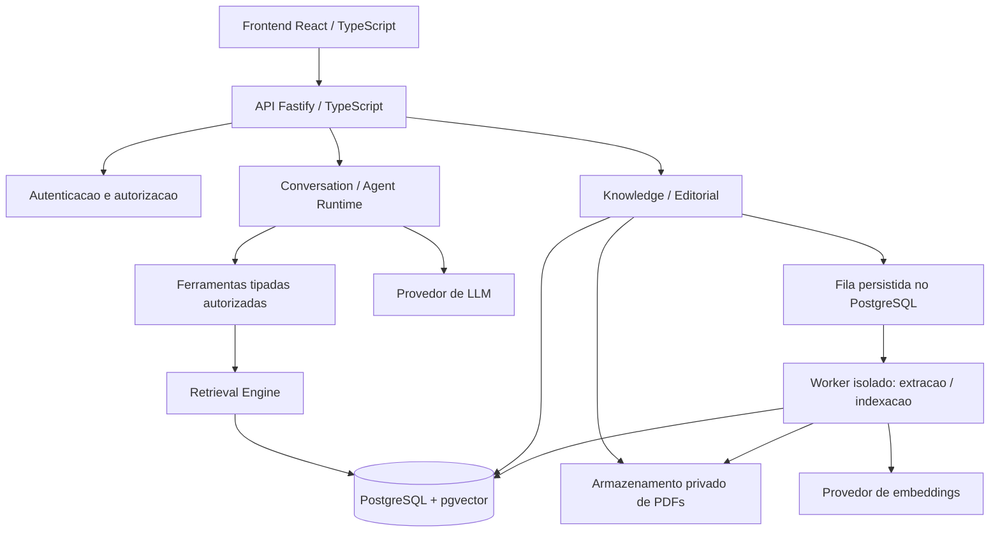

# Plano técnico — Agente de IA com cérebro de conhecimento

**ID:** `001-agente-corporativo-conhecimento`  
**Versão do plano:** `0.1`  
**Data:** `20/11/2026`  
**Estado:** `PROPOSTO — aguardando validacao tecnica; nenhuma implementacao iniciada`  
**Base:** especificação funcional `spec.md`, versão `0.7`, e `clarifications.md`.

> Objetivo: implementar um agente de IA simples para uso interno, inicialmente pela equipe de Tecnologia da Informação, com artigos e PDFs aprovados, memória conversacional e gestão de conhecimento por painel e chat. A prioridade é **segurança e confiabilidade**, não burocracia ou arquitetura distribuída.
>
> Este documento é uma proposta de arquitetura, **não uma decisão aprovada**. As decisões expressamente aprovadas pelo solicitante estão identificadas como `VALIDADO`; escolhas de implementação ainda não aprovadas estão identificadas como `PROPOSTO` ou `ABERTO`.

## 1. Insumos, contexto e limites da análise

### Insumos efetivamente examinados

- `/mnt/data/specs/001-agente-corporativo-conhecimento/spec.md` (v0.7).
- `/mnt/data/specs/001-agente-corporativo-conhecimento/clarifications.md`.
- Decisões aprovadas DEC-001 a DEC-018, especialmente DEC-010 a DEC-018.

### Insumos não disponíveis

- Não foi fornecido ou inspecionado repositório do produto, configuração de deploy, código existente ou ambiente de execução.
- Não foi encontrado arquivo de principios `.specify/memory/constitution.md` nos arquivos locais do projeto.
- Não foram definidos provedor e política contratual de uso de IA, volume de usuários, limite de gastos ou estrutura de hospedagem.

**Consequência:** arquitetura **proposta para projeto novo**, a adaptar se um repositório real for fornecido. Não presumir migração ou compatibilidade com sistemas que não foram inspecionados.

## 2. Escopo funcional do MVP

**VALIDADO:** um agente central; login próprio; somente administradores cadastram usuários, atribuem permissões e iniciam redefinições; troca obrigatória de senha após redefinição; piloto em TI; artigos e PDFs; base universal/corporativa compartilhada acessível a usuários ativos e conhecimento restrito com concessão explícita; Aprovador de Conhecimento pode aprovar a própria autoria com confirmação humana; criação/alteração pelo painel e pelo chat com revisão; sem publicação automática.

**Fora do MVP:** vários agentes, multiempresa, Teams/WhatsApp, execução de scripts/comandos remotos, SSH, alterações automaticas em sistemas de terceiros, agentes autônomos proativos, OCR de PDFs escaneados (sem decisão), classificação de sigilo adicional, recursos sofisticados de organograma e autoaprendizado sem revisão.

### Resultados observáveis do primeiro release

1. Um usuário entra com sessão válida e consulta procedimentos aprovados, recebendo fontes rastreaveis.
2. Uma pessoa sem acesso restrito não descobre nem recupera documentos restritos por API, busca, chat, citação ou memória anterior.
3. Um usuário propoe um artigo/atualização por painel ou chat, ve uma prévia e confirma um rascunho.
4. Um Aprovador de Conhecimento com concessão ao espaco publica (inclusive artigo próprio), com registro auditável; erros de indexacao não transformam rascunho em publicação.
5. Quando fontes faltam ou entram em conflito, o agente não inventa um procedimento interno.

## 3. Arquitetura proposta: monolito modular



### Modulos e limites de responsabilidade

| Modulo | Faz | Não faz |
|---|---|---|
| `identity` | Login, sessão, troca de senha, administracao de contas | Autorizar a partir de papéis alegados pelo frontend/LLM |
| `authorization` | Resolver usuário, permissões e escopo em cada operação | Delegar a decisão de acesso ao modelo |
| `knowledge` | Artigos, PDFs, versões, revisão, publicação, auditoria | Permitir que um rascunho vire fonte oficial |
| `ingestion` | Validar, extrair, fragmentar, indexar e relatar falhas | Executar scripts contidos em PDFs ou navegar na rede |
| `retrieval` | Buscar fontes publicadas, visiveis e rastreaveis | Buscar sem filtro de acesso ou retornar metadados restritos |
| `agent` | Interpretar mensagens, escolher ferramentas, conduzir dialogo | Publicar sozinho, elevar permissões ou executar shell |
| `conversations` | Guardar e reconstruir contexto autorizado | Reutilizar resumo privado após revogacao |
| `audit` | Registrar eventos técnicos/editoriais sem segredos | Guardar tokens, senhas ou prompts completos em logs |

**PROPOSTO:** React + TypeScript no navegador; Node.js + Fastify para API e worker; PostgreSQL + extensao pgvector para dados e busca semântica; PostgreSQL Full-Text Search para busca exata; Docker Compose inicialmente. Sem Redis, orquestrador multiagente, microsservicos ou fila externa no MVP.

## 4. Modelo de dados mínimo

**PROPOSTO** (estrutura conceitual, sem impor ORM):

| Entidade | Campos / invariantes principais |
|---|---|
| `users` | `id`, `email` único, hash de senha, `active`, `must_change_password`, `auth_revision`, timestamps |
| `sessions` | `id`, hash de token opaco, `user_id`, expiração, revogacao; não salvar token em claro |
| `password_resets` | hash de token temporario, `user_id`, `expires_at`, `used_at`, criado por administrador |
| `departments` | `id`, `name`, `active` (piloto com TI) |
| `user_departments` | `user_id`, `department_id` (estrutura para expansão, sem telas complexas) |
| `spaces` | `id`, `name`, `scope` (`UNIVERSAL`, `SHARED`, `RESTRICTED`), `department_id?` |
| `space_grants` | `user_id`, `space_id`, capacidades (`READ`, `DRAFT`, `EDIT`, `APPROVE`) |
| `documents` | `id`, `space_id`, `kind` (`ARTICLE`/`PDF`), `title`, `current_version_id?`, `archived_at?` |
| `document_versions` | `id`, `document_id`, `number`, `status`, conteúdo/objeto, autor, revisor, timestamps, `index_status` |
| `knowledge_chunks` | `version_id`, `ordinal`, texto, metadados de citação/página, `tsvector`, embedding |
| `ingestion_jobs` | `id`, `version_id`, etapa, tentativas, erro controlado, chaves de deduplicacao |
| `conversations` | `id`, `owner_user_id`, `authz_revision_at_last_turn`, timestamps |
| `messages` | `id`, `conversation_id`, papel, conteúdo, referências de fontes, marca de acesso/escopo |
| `pending_actions` | `id`, `user_id`, `conversation_id`, tipo, payload validado, expira, confirmado uma vez |
| `feedback` | `id`, `message_id`, tipo, comentario e referências |
| `audit_events` | ator, acao, recurso, versão, resultado, data, `request_id`, sem dados secretos |

**Regras no banco:** índices/constraints para unicidade, foreign keys, proibir referências cruzadas invalidas, transações de publicação, versão vigente única por documento, lock ou controle otimista para concorrencia, deduplicacao de jobs, exclusão lógica quando necessário. Não deixar invariantes essenciais apenas nas verificacoes do frontend.

**Acesso efetivo:** documentos herdam visibilidade do espaco. Não permitir que o documento amplie o acesso do espaco. Se um documento precisar de publico mais restrito, colocar em espaco restrito; evitar uma matriz de ACL por documento no piloto. Caso a especificação passe a exigir excecoes por documento, reavaliar esta simplificacao antes de implementar.

## 5. Contratos e fluxos essenciais

### 5.1 Autenticação e sessões

- `POST /auth/login`: credenciais locais; erros genericos; rate limit; cria sessão opaca em cookie `HttpOnly`, `Secure`, `SameSite`, com expiração no servidor.
- `POST /auth/logout`: revoga sessão. Proteger mutacoes contra CSRF conforme mecanismo de sessão adotado.
- `POST /auth/change-password`: válida sessão temporaria e senha nova; encerra fluxo de troca obrigatória, revoga tokens antigos e renova sessão.
- `POST /admin/users`: somente administrador; sem `signup` publico. Bootstrap inicial do administrador por comando de instalacao pontual, sem senha padrão.
- `POST /admin/users/:id/reset-password`: após verificacao administrativa, gerar link/código temporario de uso único e validade curta; não transmitir senhas permanentes nem registrar o segredo. Procedimento de entrega definido antes de produção.
- `PATCH /admin/users/:id/permissions`: alterar concessões; incrementar `auth_revision`, invalidar caches/contexto e auditar.

**Segurança de credenciais:** hashing moderno com parametros de custo adequados (ex.: Argon2id), TLS, controle de tentativas, cookie seguro, invalidação após desativação e redefinição; nunca armazenar senha reversivel.

### 5.2 Consultas e chat

- `POST /conversations`: cria conversa vinculada ao usuário.
- `POST /conversations/:id/messages`: recebe mensagem, verifica propriedade e conta ativa, constroi contexto seguro, orquestra modelo e ferramentas, salva resultado; limita tamanho da entrada, número de chamadas e tempo.
- `GET /conversations/:id`: válida dono; respostas historicas com referência restrita devem ser ocultadas/redigidas quando o acesso tiver sido revogado (política detalhada de retenção pendente).
- `POST /feedback`: associa avaliacao a resposta e evidências.

**Ferramentas do agente (internas, schemas tipados, sem identidade do usuário como argumento confiável):**

```ts
searchKnowledge({ query: string, limit?: number }): Promise<AuthorizedSnippet[]>;
getKnowledgeDocument({ documentId: string, versionId?: string }): Promise<AuthorizedDocument>;
findSimilarArticles({ title: string, spaceId: string }): Promise<AuthorizedReference[]>;
prepareKnowledgeDraft({ instruction: string, spaceId: string }): Promise<DraftPreview>;
proposeKnowledgeUpdate({ documentId: string, instruction: string }): Promise<DiffPreview>;
```

O backend injeta `actorId`, permissões e `requestId` a partir da sessão; o modelo nunca escolhe o usuário autenticado nem autoriza seu próprio acesso. **Não expor `publishKnowledge` ao modelo** no MVP.

### 5.3 Escrita pelo chat com confirmação humana

1. Modelo propõe artigo/alteração e consulta fontes existentes, sem gravar um artigo oficial.
2. Servidor cria `pending_action` com payload estruturado, autoria, espaco, versão de origem, prazo de expiração e ID; mostra prévia/diff.
3. Usuario confirma explicitamente o item pendente (por interface ou linguagem natural desambiguada pelo estado do servidor).
4. Backend revalida permissao, versão e entrada; cria **apenas rascunho** de forma idempotente.
5. Revisao e publicação acontecem somente via operação humana de um Aprovador de Conhecimento autorizado.

Se houver mais de uma acao pendente ou versão alterada, pedir nova confirmação; nunca interpretar um `sim` isolado como autorização generica.

### 5.4 Publicacao

- `POST /knowledge/versions/:id/submit-review`: deixa versão em fila de revisão.
- `GET /knowledge/reviews`: retorna apenas itens que o aprovador autorizado pode consultar.
- `POST /knowledge/versions/:id/publish`: exige sessão humana, capacidade `APPROVE` para espaco, confirmação explícita, versão preparada e pronta para busca, `Idempotency-Key` ou identificador equivalente; transação com `SELECT ... FOR UPDATE`/comparação otimista.
- `POST /knowledge/versions/:id/request-changes` e `.../reject`: anotam motivo e auditam.
- Autoaprovacao e permitida **somente** se o próprio autor tiver a concessão `APPROVE` no espaco.

**Publicacao atomica:** o PDF/artigo deve estar extraido e indexado antes da troca de `current_version_id`; a troca de ponteiro, estado e auditoria ocorre em uma transação. Falha de processamento mantem a versão vigente anterior, sem apresentar sucesso falso. O índice do rascunho e inacessivel a busca oficial, pois a consulta exige que a versão seja a atualmente publicada.

## 6. RAG e confiabilidade das respostas

### Pipeline de ingestão

1. Receber arquivo via endpoint autenticado e autorizado; verificar assinatura/MIME real, extensao PDF, limite de tamanho e páginas; armazenar em area privada/quarentena.
2. Processar em **worker isolado**, com limites de memória/CPU/tempo e sem acesso de rede externa desnecessario; nunca executar macros, scripts ou conteúdo ativo.
3. Extrair texto por página; normalizar e registrar referências de página/offset. Se PDF for ilegivel ou escaneado sem texto util, retornar estado `NEEDS_MANUAL_INPUT`/`FAILED_EXTRACTION`, sem fingir ingestão ou publicar.
4. Dividir em trechos preservando contexto e origem; gerar embeddings e índice textual.
5. Validar contagem/qualidade da extração e apresentar prévia ao aprovador.
6. Somente versão publicada e vigente pode atender buscas do agente.

**PROPOSTO para o MVP:** processar PDFs com texto extraivel; não adicionar OCR automático até decidir Q-012. O arquivo pode ser recebido, mas não se torna fonte oficial se não puder ser validado.

### Recuperacao

- Normalizar pergunta e coletar metadados (produto, versão, erro exato) quando presentes.
- Aplicar em SQL os predicados `published/current` e de **acesso do usuário** antes de selecionar qualquer trecho: universal/compartilhado ou concessão ativa de espaco restrito. Revalidar autorização ao construir citações e ao abrir documentos.
- Combinar busca textual (importante para codigos de erro, comandos e versões) com busca vetorial. Fusao de rankings simples, inicialmente sem servico de reranking externo.
- Limitar `top_k`, tamanho total do contexto e timeouts. Não retornar nomes/titulos de documentos proibidos nem em diagnosticos de busca.
- Registrar no backend referências `documentId/versionId/page` de cada trecho enviado ao modelo.

### Geracao e citações

- Instrucoes de sistema estabelecem uso de ferramentas, diferenciacao de fontes, citação e resposta de incerteza. Isso melhora comportamento, **mas não substitui controles no servidor**.
- Documentos são dados não confiaveis; delimitacao e filtragem de instrucoes maliciosas, sem obedecer comandos encontrados em PDFs.
- Em respostas baseadas no cérebro, validação posterior verifica que citações se referem a documentos/versões realmente recuperados e permitidos.
- Se fonte não existir, conflitar ou não cobrir a versão relevante, responder com lacuna/pergunta de esclarecimento, não inventar procedimento interno.
- Falha de retrieval ou timeout do modelo causa resposta de indisponibilidade ou conhecimento não verificado; não apresentar fonte artificial.

### Memoria conversacional e revogacao

- Não tratar histórico de chat como autorização permanente para reutilizar trechos.
- Em **todo turno**, verificar identidade, propriedade da conversa e permissões atuais.
- Mensagens/resumos derivados de fontes restritas carregam referências/escopo; após revogacao, não entram no novo prompt. Invalidar cache e resumos anteriores na mudança de `auth_revision`.
- Na interface, ocultar conteúdo histórico derivado de fontes já revogadas; preservar evento de auditoria sem expor conteúdo.
- **ABERTO (Q-007):** prazos de retenção e política definitiva de descarte; manter configurável, não definir prazo fictício agora.

## 7. Segurança como restrição de arquitetura

| Risco real | Controle verificavel |
|---|---|
| Acesso horizontal a documento/chat por ID | Checagem de propriedade e escopo em cada leitura/escrita; teste negativo por API |
| Prompt injection em PDF/artigo | Ferramentas com schema estrito; documentos não concedem permissões; tentativas de mudar instrucoes não invocam acoes privilegiadas |
| Vazamento via snippets, fontes ou memória | Filtro antes de busca; filtro na citação e leitura; inválida contexto quando permissao muda |
| Segredos acidentais em artigos/PDFs | Varredura de padrões de credenciais; bloqueio e revisão, sem logar o valor detectado |
| Upload malicioso / PDF decomposto | Limites, verificacao de formato, worker isolado, sem rede externa, falha explícita |
| Exposicao de documentos enviados | Arquivos privados; download autenticado e autorizado; sem URL publica nem servico de arquivos exposto |
| Publicacao dupla / concorrencia | Idempotencia, transação, lock e versão vigente única |
| Roubo/reuso de sessão | Cookies seguros, TLS, expiração, revogacao, rate limits, forcar troca de senha |
| Uso excessivo do modelo | Limites por usuário, tamanho de entrada, quantidade de tools, timeout e custos monitorados |
| Operacao privilegiada por agente | Não expor ferramentas de publicação, usuários, rede ou execução de shell ao LLM |

**Defesa em profundidade:** controles de autorização no servico e, se viavel na configuração do banco, políticas RLS para tabelas sensiveis; nunca utilizar `service_role`/credencial irrestrita no navegador. RLS complementa, não substitui verificacoes de aplicação.

**Requisito de implantação:** antes de enviar documentos internos a qualquer modelo/servico de embeddings externo, validar políticas de retenção/processamento de dados, contratos e se o conteúdo pode sair do ambiente interno; se não puder, selecionar provedor/implantação compatível. Esta decisão de privacidade/fornecedor esta **ABERTA** e deve ser tomada antes do uso de dados reais.

## 8. Operacao, observabilidade e resiliencia

- API e worker com health checks; logs estruturados com `requestId`, duracao, falhas, quantidade de tool calls, tokens e custo estimado, mas sem senhas, chaves, anexos ou trechos de documentos.
- Fila persistida no próprio PostgreSQL no MVP; workers usam claim transacional/lock, reintentos limitados com backoff e estado de falha consultavel. **Alternativa:** Redis + BullMQ, adiar até volume justificar.
- Backup automático do banco e armazenamento de PDFs, criptografia e **teste real de restauracao** antes de disponibilizar em produção; documentar RPO/RTO depois de conhecer ambiente.
- Segredos fornecidos por ambiente/secret store; não commitar `.env`. Conta de banco com privilegios mínimos; migracoes com papel separado quando apropriado.
- Configuracoes e limites operacionais como variaveis versionadas; migracoes incrementais e preferencialmente compativeis com versão anterior.
- Rollback de deploy por imagem anterior; se uma nova versão publicada for incorreta, reverter o ponteiro para versão anterior por acao autorizada e auditada, sem excluir histórico. Falhas de embeddings não apagam versão publicada atual.
- Fallback: ao indisponibilizar provedor LLM, a interface informa indisponibilidade; não confirmar rascunhos/publicações que não foram persistidos.

## 9. Estrategia de testes e critérios de liberacao

### Testes automatizados prioritarios

1. **Autenticação e permissões:** login, logout, desativação, reset, troca obrigatória, force-browsing a ID de conversa/documento, papéis distintos, revogacao durante conversa, admins sem concessão não publicam (`AC-001/002/003/004/013/019/020/022/023/024/025`).
2. **Ingestao de PDFs:** MIME adulterado, PDF corrompido, sem texto, muito grande, senha protegida, texto malicioso, parser timeout; sem indexacao ou publicação indevida (`AC-009/015/018`).
3. **Publicacao:** duplo clique, reenvio, duas aprovacoes concorrentes, falha após indexacao mas antes de transação, nova versão enquanto outra esta vigente, rollback lógico (`AC-010/011/014/016/018/022`).
4. **RAG:** citações para versão correta, rascunho não pesquisavel, busca por erro exato, falta de fonte, fontes contraditorias, tentativa de injetar instrucoes via PDF (`AC-003/005/006/007/015`).
5. **Memoria:** revogacao de acesso, reuso de resumo, lista de chats e citações após revogacao (`AC-004/024`).
6. **Feedback e auditoria:** referências rastreaveis; eventos sem segredos (`AC-016/017`).

### Avaliacao de qualidade com perguntas reais

- Construir conjunto versionado de perguntas de TI com resposta esperada, documento de origem, versão e classificacao (`resolvida`, `sem fonte`, `conflitante`, `restrita`).
- Avaliacao automática de citações/permissões + revisão humana de respostas técnicas; não usar avaliacao apenas pelo próprio LLM como prova de corretude.
- Casos representativos: impressoras, Windows/Linux, rede, acesso remoto, instalacao de software, incidentes, versões divergentes e pedidos vagos.
- **Metas propostas para validação no piloto (Q-009):** zero vazamentos nos testes negativos conhecidos; zero publicação por IA sem aprovação; zero citações inexistentes nos casos controlados; exigir aprovação humana de amostra de respostas operacionais antes da liberacao. Metas numericas de acuracia, latencia e custo serao definidas com dados reais, não inventadas como se aprovadas.

### Rollout

- Ambiente local/dev com documentos fictícios -> teste de integracao usando banco real isolado -> homologacao com base de TI revisada -> piloto com poucos colaboradores -> liberacao interna.
- Gate de implantação: restauracao de backup testada, HTTPS, credenciais sem vazamento, controles de acesso negativos aprovados, publicação atomica e regressao de RAG em cenarios conhecidos.
- Sem código ou deploy antes da aprovação deste plano e da decomposicao em tarefas.

## 10. Decisões significativas e alternativas

| Tema | Proposta | Alternativa real | Troca / reversibilidade | Estado |
|---|---|---|---|---|
| Estrutura | Monolito modular Fastify + worker | Microsservicos | Menor operação; extração de servicos possível depois | PROPOSTO |
| Dados e busca | PostgreSQL + pgvector + full-text | Banco vetorial separado | Mais simples e transacional; escalar busca separadamente futuramente | PROPOSTO |
| Fila | Tabela de jobs + locks PostgreSQL | Redis/BullMQ | Menos componentes; pode migrar mantendo contrato do worker | PROPOSTO |
| Modelo | Um LLM com tool calling e adaptador de provedor | Framework multiagente | Menos complexidade e melhor auditabilidade; trocar provedor por adaptador | PROPOSTO |
| PDFs escaneados | Falha explícita sem OCR no MVP | OCR automatizado | Mais previsivel e seguro; OCR pode ser incluido depois | PROPOSTO; Q-012 ABERTO |
| Arquivos | Armazenamento privado com backup; local protegido ou S3 compatível | Blob remoto obrigatorio desde o início | Escolher pela infraestrutura disponível e restauracao | ABERTO |
| Permissoes | Espacos compartilhados/restritos + grants | ACL individual por documento | Menos regras; excecoes exigiriam espaco dedicado | PROPOSTO |
| Credencial temporaria | Token de uso único com expiração curta, via administrador | Senha provisoria distribuída | Evita circular senha permanente; exige processo seguro de entrega | PROPOSTO |
| Hospedagem IA | API externa somente com autorização de dados | Modelo em infraestrutura interna | Custo/privacidade/qualidade; depende das políticas de dados | ABERTO |

## 11. Riscos e dependencias por prioridade

| Prioridade | Risco / dependencia | Acao antes de liberar |
|---|---|---|
| P0 | Documento restrito vaza em RAG, histórico ou citação | Testes de isolamento e revogacao com usuários distintos e fontes maliciosas |
| P0 | Modelo executa operação privilegiada sem usuário | Tools estritas e exclusão de publicação/administracao do agente; testes de abuso |
| P0 | PDF malicioso ou conteúdo com credenciais entra no cérebro | Worker isolado, validação, análise de segredos e revisão humana |
| P0 | Conteudo não indexado ou revisão aparece como publicado | Estado/editorial com transação, ponteiro de versão vigente e regressao de falhas |
| P0 | Dados internos enviados a provedor não aprovado | Escolha documentada de provedor e regra de tratamento de dados antes do piloto |
| P1 | Resposta tecnicamente incorreta apesar de citação | Dataset de TI, revisão humana, mecanismos de incerteza e versão por produto |
| P1 | Uso/custo/latencia do modelo inviabiliza uso cotidiano | Telemetria, limites, benchmark com carga esperada |
| P1 | Falha de backup sem capacidade de restaurar | Teste de restore e runbook |

## 12. Rastreabilidade REQ / AC

| Area do plano | REQ cobertos | AC de verificacao |
|---|---|---|
| Login, contas, sessões e redefinição | REQ-001, REQ-027, REQ-029 | AC-001, AC-019, AC-023, AC-025 |
| Departamentos, espaços e concessões | REQ-002, REQ-003, REQ-004, REQ-005, REQ-021, REQ-028 | AC-002, AC-003, AC-004, AC-020, AC-021, AC-024 |
| Conversacao e RAG | REQ-006 a REQ-010 | AC-003 a AC-007 |
| Criacao/importacao/atualização | REQ-011 a REQ-016 | AC-008 a AC-012 |
| Revisao, publicação, versões | REQ-017 a REQ-020 | AC-013, AC-014, AC-020, AC-022 |
| Segredos, injeção, auditoria, feedback, falhas | REQ-022 a REQ-026 | AC-009, AC-015 a AC-018 |

**Cobertura de todos os IDs:** REQ-001 a REQ-029 e AC-001 a AC-025 foram mapeados; sobreposicoes entre areas são intencionais.

## 13. Pendencias e próximo marco

**Decisões já validadas e preservadas:** DEC-001 a DEC-018, conforme `spec.md`; este plano não altera essas decisões.

**Bloqueadores reais de uso com dados internos (não bloquear criação de código fictício):**

- **Privacidade/provedor:** verificar se documentos internos podem ser processados pelo LLM e embeddings escolhidos (crítico).
- **Retencao (Q-007):** período mínimo e tratamento de históricos persistidos, especialmente após revogacao; comportamento seguro provisório definido no item 6.
- **PDF escaneado (Q-012):** aprovar tratamento sem OCR no MVP ou investir em OCR com testes adicionais.
- **Responsaveis pelo piloto (Q-011):** uma pessoa para curar artigos e validar respostas; detalhes podem ser definidos perto da homologacao.
- **Métrica operacional (Q-009):** baselines de custo, tempo e qualidade a medir no teste com TI.

**Próximo passo SDD:** revisar/validar este `plan.md`, depois decompor em tarefas pequenas `tasks.md` com dependencias e testes, e so entao implementar. Este arquivo **não autoriza alteração de código**.